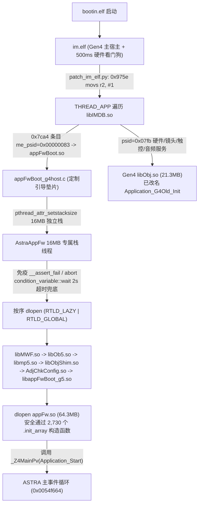
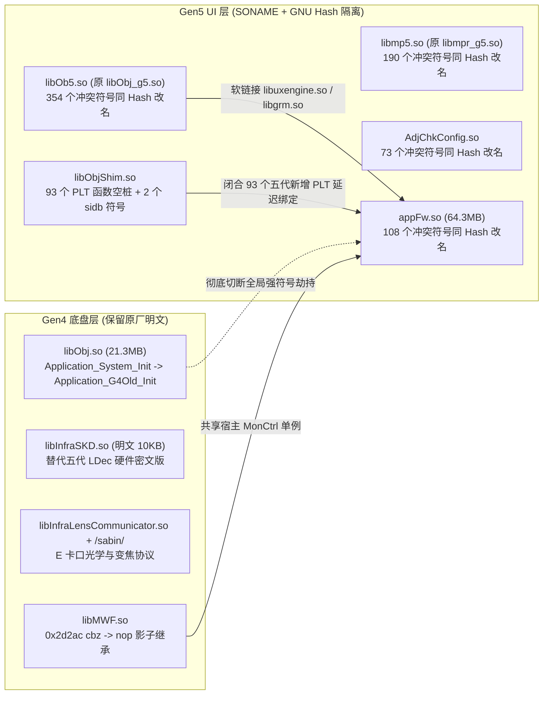
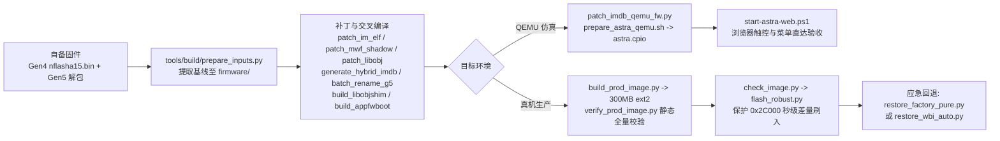

# 系统架构总览 (`docs/architecture.md`)

本文档从 **启动加载链路**、**跨代符号隔离**、**双目标触控与渲染数据流**、**开源复现构建流水线** 四个维度描述 Sony ZV-E10（Gen 4）跨代运行 Sony ZV-1M2（Gen 5 ASTRA）的完整软件架构。

---

## 1. 跨代宿主加载与启动链架构

四代宿主 `im.elf` 通过 `bootin.elf` 启动，加载剪裁后的 `libIMDB.so`，并将原本直指四代 UI 的 `Application_System_Init` 重定向至定制引导垫片 `appFwBoot.so`（编译自 `src/appFwBoot_g4host.c`）。引导垫片创建 **16MB 专属栈线程**，在隔离保护下完成五代依赖闭包加载与 `appFw.so` 初始化，最后转交五代原厂引导器 `_Z4MainPv(Application_Start)` 点火进入主事件循环。

---

## 2. 跨代符号隔离与双代共存架构

直接将五代库丢进四代 `/usr/lib` 会因同名全局符号（如 `UXEngine`、`GRM`、`CEC` 等）和硬件密文库（五代 `libInfraSKD.so`）引发 `SIGILL` 或虚表错乱（`fault=0x234`）。通过“保留四代硬件底盘 + 五代 `DT_SONAME` 改名 + GNU Hash 等长同哈希符号重命名 + `libObjShim.so` 空桩补全 + `libMWF.so` 影子继承”五重手段实现双代安全共存。

---

## 3. 双目标触控交互与显示渲染数据流

`src/appFwBoot_g4host.c` 通过编译宏（默认 QEMU 软光栅模式，`-DZVE10_REAL_DEVICE` 真机生产模式，`-DZVE10_USB_SANDBOX` 真机 USB 沙盒模式）适配两种截然不同的图形与输入后端：

```mermaid
flowchart TB
    subgraph QEMU["QEMU 仿真目标 (--target qemu)"]
        WebUI["浏览器前端 astra_web_ui.html"] -->|"HTTP POST /api/touch /api/key"| WebPy["astra_web_qemu.py"]
        WebPy -->|"Serial Socket (/dev/ttyAM0)"| UartRx["uart_touch_rx_thread"]
        UartRx -->|"TOUCH -> WidgetSystem::postMouse*"| UXQ["libOb5.so WidgetSystem"]
        UartRx -->|"KEY -> g5_tact_key_table"| KeyQ["appFw.so 按键分发器"]
        UXQ --> SwRender["软光栅 Hook (sw_dmp_blit / glClear / swapBuffers)\n+ Morton Z-order RGBA4444 编码"]
        SwRender -->|"写入保留物理显存 0x20000000"| VRAM["QMP pmemsave 抓帧 -> PNG"]
        VRAM --> WebUI
    end

    subgraph RealDevice["真机生产目标 (--target real)"]
        TP["Gen4 libInfraTp (psid=0x07fb)"] -->|"0x026c 触控事件 (640x480 + 翻转方向)"| AppLoop["appFw.so 主循环 (0x0054f83e)"]
        AppLoop -->|"驱动 WidgetSystem"| UXReal["libOb5.so UXEngine"]
        G4Handoff["g4_handoff_real_device\n停靠四代 RM 释放 /dev/dmpgles2"] --> RealGL["硬件 GLES 渲染输出至 LCD"]
    end
```

---

## 4. 开源复现构建与验证流水线

---

## 5. 仓库核心文件职责映射

| 路径 | 职责说明 |
| :--- | :--- |
| `src/appFwBoot_g4host.c` | 跨代引导器核心源码：16MB 栈线程、Hook 装甲、QEMU 软光栅与 UART 触控/按键注入、真机 RM 交接 |
| `src/libObjShim.S` | 五代新增符号空桩汇编源码（93 个函数桩 + 2 个 `sidb` 数据符号） |
| `manifests/rename_plan.json` | 经闭包分析验证的 557 个跨代冲突符号等长同 Hash 改名映射表 |
| `manifests/prod_image_manifest.json` | 生产镜像删减旧 Gen4 UI 库、注入新 Gen5 库与软链接的清单 |
| `tools/build/prepare_inputs.py` | 从用户自备 `nflasha15.bin` 与 ZV-1M2 解包目录一键提取输入基线 |
| `tools/build/elf_samehash_rename.py` | `.dynstr` 原地修改且保持 `.gnu.hash` 不变的符号隔离引擎 |
| `tools/build/build_prod_image.py` | 基于 WSL `resize2fs`/`debugfs`/`e2fsck` 生成 314,572,800 B 生产镜像 |
| `tools/build/verify_prod_image.py` | 离线校验镜像大小、9 个核心 `.so` ABI/GOT/Hook、全库 `DT_NEEDED` 闭包与资源属主 |
| `tools/qemu/astra_web_qemu.py` | QEMU `-M zve10` 守护进程、QMP 显存抓取、RGBA4444 C 解码与 Web 触控后端 |
| `tools/flash/flash_robust.py` | 带 `0x2C000` 扇区保护、掉线断点续传与 `--diff-from` 差量刷写器 |
